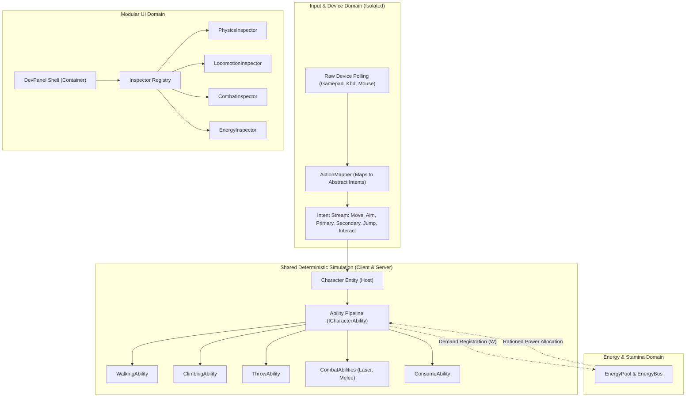
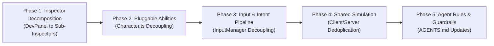

# Codebase Segmentation & Isolation Plan: Eliminating Agent Blast Radius

## Executive Summary

When an AI coding agent is tasked with modifying or adding a game feature (such as tuning a combat ability, adjusting stamina drain, or changing input bindings), it frequently modifies unrelated subsystems or introduces regressions in neighboring mechanics. 

An in-depth architectural audit of the project reveals that this issue is not caused by agent intent, but by **structural coupling and monolithic consolidation points ("God files")** where vertical slices of every mechanic intersect. 

This document analyzes the root causes of cross-subsystem collateral damage and details an actionable, phased plan to segment the codebase into **isolated, single-responsibility domains with strict boundaries**.

---

## 1. Root Cause Analysis: Why Agents Cause Cross-Subsystem Breakage

### 1.1 The "God Files" Cross-Contamination Hubs
A small number of massive files aggregate disparate mechanics across the game:

| File | Lines | Size | Responsibilities Accumulated |
| :--- | :--- | :--- | :--- |
| `src/ui/DevPanel.ts` | 5,833 | ~304 KB | Inspects **every** physical module, locomotion state, combat ability, energy pool, preset, spawner, and arena setting in one 4,000-line rendering function. |
| `src/ui/InputManager.ts` | 2,068 | ~81 KB | Directly checks keys and buttons for aim, throw, drop, jump, climb, sprint, laser, melee, eating, hotkeys, and camera viewports. |
| `src/engine/PlayerManager.ts` | 1,832 | ~75 KB | Maps multi-device inputs directly to character states, action queues, and capability activations. |
| `src/engine/GameLoop.ts` | 1,612 | ~69 KB | Orchestrates physics, state history snapshots, rollback reconciliations, rendering passes, spawners, and input updates. |
| `src/engine/Renderer.ts` | 1,713 | ~66 KB | Handles split-screen camera transforms, rollback paths, cursor aiming, and debug bounds alongside pass execution. |
| `src/server/ServerGameSimulation.ts` | 1,494 | ~63 KB | Headless simulation duplicating gameplay mechanics (eating, melee impacts, pickups) separately from client logic. |
| `src/character/Character.ts` | 1,122 | ~45 KB | Explicitly imports and holds fields for 10+ capability modules, and inline-calculates power demands inside its `update()` method. |

### 1.2 The "Vertical Slice Sprawl" Problem
When an agent is asked to implement or modify an ability (for example, **Laser Blast** or **Melee Attack**), the mechanic does not exist in isolation. Its logic is sprawled across 8 separate files:
1. `LaserModule.ts` (ability parameters)
2. `Character.ts` (stores flags `isLaserAiming`, `isLaserFiring`, `laserAimTarget`, and calculates power demand in `update()`)
3. `InputManager.ts` (polls Left Control and Left Click, tracks `isLaserAiming` in `GamepadSlotState`)
4. `PlayerManager.ts` (routes input flags from `InputManager` to `Character`)
5. `ServerGameSimulation.ts` (handles authoritative laser action and damage application)
6. `DevPanel.ts` (hardcodes ~250 lines of HTML sliders and event listeners inside `renderEntityModules()`)
7. `EnergyHud.ts` (renders anticipated modifier tags and live bar previews)
8. `Renderer.ts` / `LaserRenderer.ts` (draws the beam)

Because the agent is forced to open and modify `Character.ts`, `DevPanel.ts`, `InputManager.ts`, and `PlayerManager.ts` to wire up a single mechanic, it frequently:
- Accidentally mutates adjacent lines handling climbing, walking, or throwing.
- Introduces syntax errors or mismatched braces in 5,000-line files.
- Modifies shared state bags (e.g. `GamepadSlotState` or `AnticipatedModifier`) in ways that regress other features.

---

## 2. Target Architecture: Firewalls of Isolation

To prevent an agent working on Aspect A from altering Aspect B, the system must enforce **strict spatial and interface boundaries**. A developer or agent should be able to touch one directory or module without any knowledge of or access to unrelated mechanics.



---

## 3. The 6 Pillars of Code Segmentation

### Pillar 1: Pluggable Capability Architecture (`ICharacterAbility`)
Remove hardcoded capability references, state flags, and inline power demand equations from `Character.ts`.

#### Interface Definition
```ts
export interface AbilityContext {
  character: Character;
  arena: Arena;
  dt: number;
  energyPool: EnergyPool | null;
  registry: ObjectPropertiesRegistry;
}

export interface ICharacterAbility {
  readonly id: string;
  readonly name: string;
  enabled: boolean;
  
  // Power & Resource Contract
  consumesEnergy: boolean;
  allowPartialPower: boolean;
  getDemandedPower(context: AbilityContext): number;
  getAnticipatedModifiers(context: AbilityContext): AnticipatedModifier[];
  
  // Simulation Lifecycle
  update(dt: number, context: AbilityContext): void;
  reset(): void;
}
```

#### Decoupled `Character` Entity
`Character` becomes an entity container that manages dynamic properties, physical state, and an ability map:
```ts
export class Character extends GameObject {
  private abilities = new Map<string, ICharacterAbility>();

  public registerAbility(ability: ICharacterAbility): void {
    this.abilities.set(ability.id, ability);
  }

  public getAbility<T extends ICharacterAbility>(id: string): T | undefined {
    return this.abilities.get(id) as T | undefined;
  }

  public override update(dt: number, arena: Arena): void {
    super.update(dt, arena);
    const context: AbilityContext = {
      character: this,
      arena,
      dt,
      energyPool: this.energyPool,
      registry: this.properties,
    };

    // 1. Begin energy tick & gather demands dynamically
    this.energyPool?.beginTick();
    for (const ability of this.abilities.values()) {
      if (!ability.enabled || !ability.consumesEnergy) continue;
      const watts = ability.getDemandedPower(context);
      if (watts > 0) {
        this.energyPool?.registerDemand(ability.id, watts, ability.allowPartialPower);
      }
    }

    // 2. Ration energy across demands
    this.energyPool?.resolveRationing(dt);

    // 3. Tick each ability independently
    for (const ability of this.abilities.values()) {
      if (ability.enabled) {
        ability.update(dt, context);
      }
    }
  }
}
```
**Isolation Benefit**: An agent editing or adding an ability works **strictly inside its own file** (e.g. `src/character/abilities/LaserAbility.ts`). It does not need to edit `Character.ts`.

---

### Pillar 2: Sub-Inspector Registry for DevPanel
Decompose the 5,833-line `src/ui/DevPanel.ts` into self-contained sub-inspectors in a dedicated directory: `src/ui/inspectors/`.

#### Folder Structure
```
src/ui/inspectors/
  ├── IModuleInspector.ts         // Shared inspector interface
  ├── InspectorRegistry.ts        // Registry registering all sub-inspectors
  ├── PhysicsInspector.ts         // Rigidbody, Collider, Friction, Bounce, Gravity, Roll
  ├── LocomotionInspector.ts      // Walking, Climbing, Jump, Edge Assist
  ├── InteractionInspector.ts     // Pickup, Throw, Consume
  ├── CombatInspector.ts          // Laser, Melee, Health, Damage Solver
  ├── EnergyInspector.ts          // EnergyPool, Stamina, Energy Bus
  ├── PrefabInspector.ts          // Prefab creator, spawner configuration
  └── ArenaInspector.ts           // Arena dimensions, wall heights, tiles
```

#### Shared Interface
```ts
export interface IModuleInspector {
  readonly id: string;
  readonly title: string;
  canInspect(entity: GameObject): boolean;
  render(container: HTMLElement, entity: GameObject, context: DevPanelContext): void;
}
```

#### Resulting `DevPanel.ts`
`DevPanel.ts` drops from **5,833 lines to ~250 lines**. It serves exclusively as a layout frame that queries `inspectorRegistry.getInspectorsFor(this.selectedEntity)` and mounts their HTML.

**Isolation Benefit**: When an agent modifies the UI for Laser or Throwing, it modifies **only** `CombatInspector.ts` or `InteractionInspector.ts`. It cannot break locomotion, arena, or physics controls.

---

### Pillar 3: Decoupled Input & Action Intent Pipeline
Break `src/ui/InputManager.ts` and `src/engine/PlayerManager.ts` into three distinct tiers:

1. **Hardware Polling (`src/input/hardware/`)**:
   - `KeyboardMouseService.ts`: Captures raw keycodes, mouse coordinates, and wheel deltas.
   - `GamepadService.ts`: Reads raw gamepad axes, triggers, and buttons with deadzone filtering.
   - Has **zero** knowledge of game mechanics, weapons, climbing, or characters.

2. **Action Mapping & Intent (`src/input/actions/`)**:
   - Translates raw inputs into high-level abstract intents:
     - `MoveIntent(x, y)`
     - `AimIntent(targetX, targetY, isDirectional)`
     - `ActionIntent(actionId: "primary" | "secondary" | "jump" | "climb" | "melee" | "interact", phase: "start" | "hold" | "release", value: number)`

3. **Character Controller (`src/character/controllers/`)**:
   - `PlayerCharacterController.ts`: Binds an input stream to a character's registered abilities.
   - Abilities subscribe to action intents:
     - `ThrowAbility` listens for `primary` when holding an object.
     - `LaserAbility` listens for `secondary` + `primary`.
     - `MeleeAbility` listens for `melee`.

**Isolation Benefit**: Changing the keybinding or trigger threshold for melee attack does not touch cursor aiming, throw charging, or DevPanel hotkeys.

---

### Pillar 4: Shared Deterministic Gameplay Systems (Client/Server Parity)
Currently, `GameLoop.ts` (client) and `ServerGameSimulation.ts` (server) duplicate headless mechanics:
- Food calorie consumption and scale reduction
- Melee impact impulse, shock damage, and knockback
- Contested grab resolution

#### Extraction Plan
Extract shared mechanics into pure, deterministic simulation systems under `src/simulation/`:
- `src/simulation/CombatSystem.ts`
- `src/simulation/ConsumptionSystem.ts`
- `src/simulation/InteractionSystem.ts`

Both `GameLoop.ts` and `ServerGameSimulation.ts` call the exact same pure functions.

**Isolation Benefit**: An agent updating the math for consumable eating or melee damage edits one single simulation function. Neither client prediction nor server authority can fall out of sync.

---

### Pillar 5: Camera & Viewport Isolation
`src/engine/Renderer.ts` currently mixes pass rendering with:
- Multi-player split-screen coordinate calculations
- Screen-to-world and world-to-screen projection matrices
- Camera smoothing and tracking

#### Extraction Plan
Extract these responsibilities into `src/engine/camera/CameraManager.ts`. `Renderer.ts` receives pre-computed camera viewports and executes its render passes (`EntityPass`, `ShadowPass`, `WallRoofPass`, `LaserRenderer`, `TrajectoryRenderer`).

**Isolation Benefit**: Rendering enhancements or shader passes cannot corrupt camera bounds or split-screen views.

---

### Pillar 6: Guardrail Boundaries & File Tiering in `AGENTS.md`

Update `AGENTS.md` to define strict domain silos and agent blast-radius rules:

#### New Tier 3: Isolated Subsystems (Single-Responsibility Domain Rules)
- **Combat Domain**: Edits restricted to `src/character/abilities/combat/` and `src/ui/inspectors/CombatInspector.ts`.
- **Locomotion Domain**: Edits restricted to `src/character/abilities/locomotion/` and `src/ui/inspectors/LocomotionInspector.ts`.
- **Input Domain**: Edits restricted to `src/input/actions/` and `src/input/hardware/`.
- **UI Domain**: Edits restricted to `src/ui/inspectors/` and `src/ui/components/`.

#### The "Single Domain Rule"
> **CRITICAL AGENT CONSTRAINT**:
> When an agent is working on a feature or bug within a specific domain (e.g. Combat, Locomotion, Input, UI), the agent is **strictly prohibited from editing files in other domains**. If a cross-cutting change is needed, it must be mediated via an established interface or registry contract.

---

## 4. Phased Implementation Roadmap

To avoid breaking existing gameplay or conflicting with active branches, the refactoring is divided into 5 low-risk sequential phases:



### Phase 1: `DevPanel.ts` Inspector Decomposition (Immediate 80% Blast Radius Reduction)
- **Risk**: Very Low (Pure UI refactoring, zero gameplay or physics impact).
- **Actions**:
  1. Create `src/ui/inspectors/IModuleInspector.ts` and `src/ui/inspectors/InspectorRegistry.ts`.
  2. Extract `PhysicsInspector.ts` (handles Rigidbody, Collider, Friction, Bounce, Gravity, Roll).
  3. Extract `LocomotionInspector.ts` (handles Walking, Climbing, Jump, Edge Assist).
  4. Extract `CombatInspector.ts` (handles Laser, Melee, Health, Damage Solver).
  5. Extract `EnergyInspector.ts` (handles EnergyPool, Stamina, Bus allocation).
  6. Extract `InteractionInspector.ts` (handles Pickup, Throw, Consume).
  7. Reduce `DevPanel.ts` to a clean container shell.

### Phase 2: Pluggable Ability Architecture
- **Risk**: Low (Maintains backward-compatible property getters on Character).
- **Actions**:
  1. Define `ICharacterAbility` interface in `src/character/ICharacterAbility.ts`.
  2. Implement `LaserAbility.ts`, `MeleeAbility.ts`, and `ConsumeAbility.ts` conforming to `ICharacterAbility`.
  3. Update `Character.ts` to delegate power demand and ticks to `abilities.values()`.
  4. Provide backward-compatible accessor properties (`char.laserModule`, `char.throwModule`) so existing references continue to work seamlessly.

### Phase 3: Input Intent Pipeline
- **Risk**: Medium (Affects gamepad/keyboard polling).
- **Actions**:
  1. Extract `HardwareInputService.ts` from `InputManager.ts`.
  2. Define `ActionMapper.ts` that maps raw keys/buttons to high-level intents (`aim`, `primary`, `secondary`, `melee`, `jump`).
  3. Connect abilities directly to action listeners.

### Phase 4: Shared Gameplay Simulation
- **Risk**: Medium (Ensures client-server deterministic parity).
- **Actions**:
  1. Extract `ConsumptionSystem.ts` (eating rates, calorie transfer, volumetric shrinking).
  2. Extract `CombatSystem.ts` (melee hit resolution, laser raycast damage).
  3. Reference shared systems in both `GameLoop.ts` and `ServerGameSimulation.ts`.

### Phase 5: Architectural Enforcement in `AGENTS.md`
- **Risk**: Zero.
- **Actions**:
  1. Formalize Tier 3 subsystem domains in `AGENTS.md`.
  2. Document the single-domain modification rule for future coding agents.
  3. Add directory-level barrel export (`index.ts`) boundaries across `src/character`, `src/ui`, `src/input`, and `src/simulation`.

---

## 5. Verification & Safety Criteria

At every phase of the migration:
1. **Compilation Check**: `npx tsc --noEmit` must pass with zero errors.
2. **Deterministic Parity**: Headless physics simulations (`npm run build:server`) must build cleanly and yield identical trajectory/energy snapshots.
3. **Sealed File Integrity**: No Tier 1 sealed files (`FrictionModule`, `BounceModule`, `RollModule`, `GravityModule`, `VerticalPositionModule`, `Arena`, `ColliderModule`, `RigidbodyModule`, `JumpModule`, `WallEdgeAssistModule`, `StateHistoryBuffer`, `IslandManager`) will be modified without explicit permission.
4. **Git Discipline**: Every completed phase will be committed and pushed immediately to `origin feat/dynamic-property-references`.
